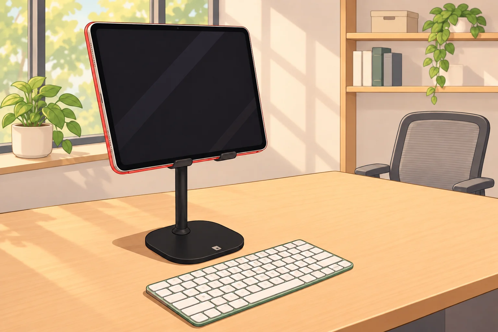
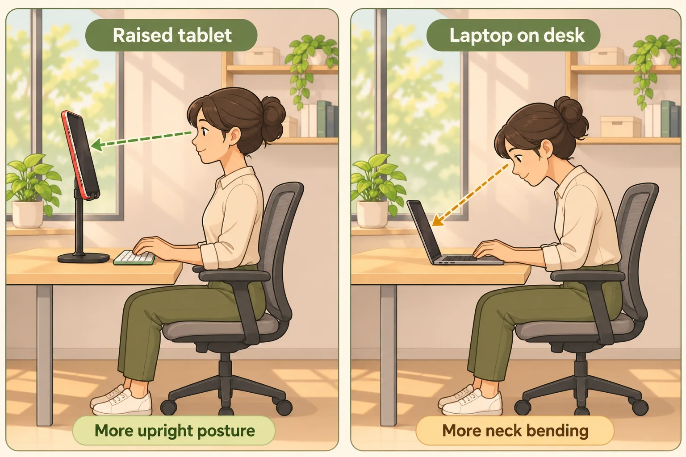
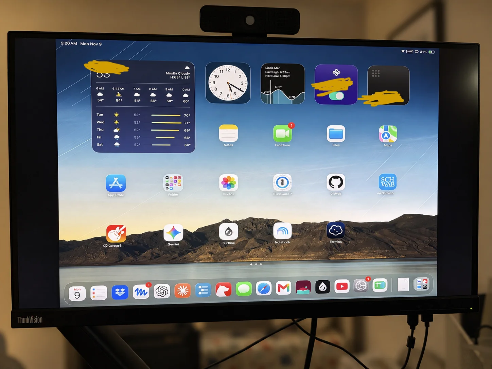

+++
date = '2026-11-09T16:54:27-08:00'
draft = false
title = 'Using iPad as The Daily Computer'
tags = ['diy', 'laptop', 'ipad', 'computer', 'ergonomic', 'monitor', 'agent']
categories = ["Life"]
+++

For the past few weeks I have been using my 12.9 inch iPad Pro as the main computer, with a Mac Mini as the backup. I find it to be quite viable with some caveats. This is what my iPad setup looks like:

## Better ergonomic than a laptop at home

This should be clear in the picture above but with the stand iPad is delightfully much better ergonomic-wise than laptop. The laptop keeps us heads down which can hurt the neck and shoulder for a prolonged use.
Of course, this applies only to the situations where one does have access to a stand for the iPad and can use a detached keyboard for it. It just happens to work for me because we live in a 2 floor house, and my Mac is sitting in my office on the 2nd floor. My portable computer use cases almost all happen on the 1st floor, where I could definitely put a stand and Bluetooth keyboard for the iPad to use.

## Cover most of my use cases

My main computer usage are three: web browsing, writing, and coding. Web browsing is straightforward and same on iPad vs laptops or desktops. Writing works mostly bc softwares I use to write all have iPad version and can sync across devices. 

The one big gap previously is coding: iPad might have ok support for writing the code (I’m not sure), but definitely does not have a good code compilation/execution environment, aka developer tools + interface (e.g. a terminal, or full featured IDE). However the emergence of agents almost closes the gap for me: I use ChatGPT (or Codex?) app to remotely access the projects on my Mac, and have it work on and run them there, which does have its compilation/execution environment and access to the file system on the Mac. This works surprisingly well for 99% of time while there’s 1% when I need terminal access. To cover the latter, I use a terminal app on iPad to remotely access my Mac via the “remote login” feature on the Mac. At home it works well but outside one needs extra setup to route traffic from iPad to Mac at home securely. Since this is a very rare case I’m fine without it so far - most of time I’ve pushed my agents to use the terminal and it works surprisingly well. 

This is possible only bc the Mac is running even when it’s asleep - not sure if the same works for a laptop. 

To be sure, using iPad still has some gaps compared to the Mac:
1. File management as the concept of files is an afterthought on iPad and very clunky to use
2. Spreadsheeting is a surprisingly limited function on iPad apps (e.g. Google sheet), and the web version is unusable with a touchscreen
3. Some iPad apps are missing features compared to their Mac counterparts

I don’t expect them to change substantially except maybe #3 when developers come to it, since iPadOS is stable and even stagnant and not a focus of Apple anymore. But fortunately I encounter them infrequent enough for them to be tolerable. 

## Monitor support is limited and several paper cuts 

Finally, let’s talk about its issues. The biggest issue is a very limited support for monitors. While both iPad and laptop have portability, it is usually more productive to have a larger display in a fixed work setting. Unfortunately, that’s where iPad falls short:

You probably see the problem: iPad couldn’t use the full resolution of the monitor. I’ve searched everywhere but there’s no way to stretch or fit it to the larger and different aspect ratio. It’s still usable but clearly caps the productivity in a certain way. 

For some reasons my iPad also feels laggy when typing and doing some other operations such as search via spotlight, something might be specific to my iPad. 

All things considered, iPad provides me a good portable alternative to a traditional laptop with better ergonomics and surprisingly parity in most tasks. I will report again if I ever change my computer setup again.