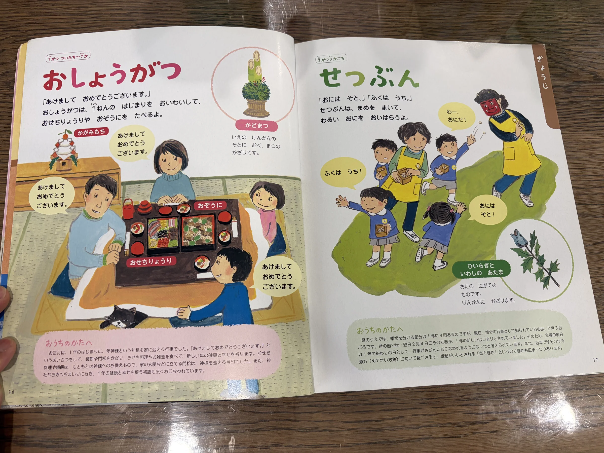

+++
date = '2026-09-13T14:31:45-07:00'
draft = true
title = 'What Books Are Good for Adults to Learn Japanese'
+++

> BIG CAVEAT: the recommendation below requires a decent knowledge of _Kanji (汉字)_.

- ehon
- kid enclopedia
- kid books
- ehon jiten

After rounds of going to library, I finally found the best type of books to learn Japanese as an adult. They are called Japanese Kanji picture dictionary (漢字絵辞典), and they look like this:

Why it's the best: