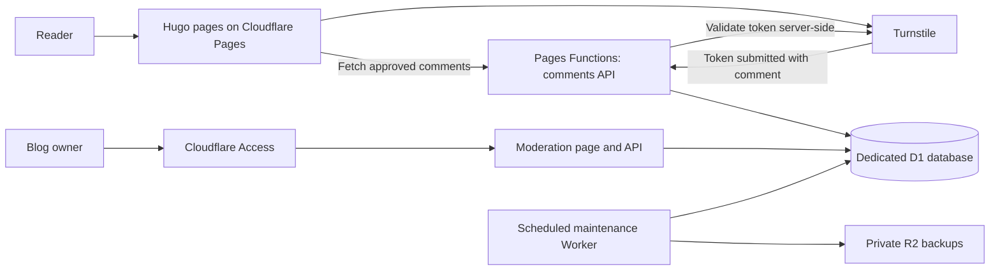

# Custom comments: design and maintenance

Status: initial implementation is in the repository; production setup remains pending. This document records the design rationale. Deployment, current behavior, and maintenance instructions are in [OPERATIONS.md](OPERATIONS.md). Reviewed against the repository and provider documentation on 2026-11-03. Defaults below are recommendations for a small personal blog, not measurements of its current traffic.

Implementation choices: public reads use `no-store` rather than an edge cache; cleanup runs hourly and backups daily; physical expiry of transient records can lag the 48-hour TTL by up to one cleanup interval. See the operations guide for these details.

## Recommendation

Build a small guest-comment system using the existing Hugo site and Cloudflare Pages Functions, with a dedicated D1 database. Readers can submit without an account; every submission needs approval before publication. Use Turnstile to discourage bots and Cloudflare Access to protect moderation. A small scheduled Worker handles cleanup and backups.

The objective is a pleasant comment box with manageable upkeep. Keep the scope narrow enough that maintaining it remains worthwhile. Include a tested export to Remark42 from the first release.

## 1. Reader and moderator experience

Comments appear beneath blog posts, matching the current light/dark theme. Enable them only on published posts, respect `comments = false`, and leave About, Apps, and Activity pages out by default.

Readers see approved comments in chronological order, initially 50 at a time with a “Load more” button. The form has an optional display name and a required comment. An empty name becomes “Reader.” Explain before submission: “Comments appear after review. Your name and comment will be public.” A successful submission says “Thanks—your comment is awaiting review”; it does not insert an apparently published comment into the public list.

Use plain text with line breaks. Start with flat comments, no attachments, rendered HTML, Markdown, reactions, or reader accounts. Do not collect email in v1: there are no reply notifications to justify storing it. Guests cannot edit or delete through an account; publish an owner contact method for correction/removal requests before launch. Display names are unverified, and only comments created through the admin interface receive an owner badge.

The form preserves entered text while open if submission fails, refreshes expired Turnstile challenges, and distinguishes rejection, throttling, paused submissions, and service failure. Accessible labels, keyboard operation, status announcements, and a no-JavaScript explanation are part of the initial implementation. Do not persist drafts in shared-browser storage by default.

The owner gets a mobile-friendly moderation page with pending comments, post links, approve/reject/spam actions, bulk spam deletion, removal of published comments, and an owner-comment form. It also shows oldest pending age, usage, last successful backup/cleanup, and switches to pause submissions globally or on one post. Avoid moderator editing of readers' words; remove a comment or request a replacement instead.

## 2. Components and boundaries

| Component | Responsibility |
| --- | --- |
| Hugo partial and small browser script | Comment list, form, status messages, theme/accessibility integration |
| Pages Functions | Public reads/submissions, moderation API, server-side validation and admission limits |
| Dedicated D1 database | Comment records, moderation state, post identity, settings and admission counters |
| Turnstile | Bot challenge, verified by the submission endpoint |
| Cloudflare Access | Owner authentication; separate protection for the moderation page and API |
| Scheduled Worker and private R2 bucket | Daily retention cleanup and backup; record job success/failure |

This builds on `layouts/_default/single.html`, the existing `functions/api/` structure, and `wrangler.toml`. Keep comment records out of the public Git repository and generated `public/` output. Existing reactions continue using their KV binding; comments use D1 because moderation, indexing, and transactional admission need stronger coordination.

Use explicit Pages invocation routes for APIs and necessary admin checks. Static posts/assets must bypass Functions, and no site-wide middleware should make reading a post depend on D1. Pages supports [D1 bindings](https://developers.cloudflare.com/pages/functions/bindings/) and [explicit Function invocation routes](https://developers.cloudflare.com/pages/functions/routing/). A dedicated comment database isolates its data and restores, but Workers/D1 account allowances can still be shared with other features.

## 3. Storage, identity, and API

| Record | Main fields |
| --- | --- |
| Post | Immutable comment key, current canonical URL, historical URL aliases, open/closed state |
| Comment | UUID, post key, optional parent ID, display name, plain-text body, UTC creation time, moderation state, publication time, owner flag |
| Moderation event | Comment ID, owner identity, action, UTC time; no duplicate copy of the comment body |
| Settings | Global open/paused state, admission thresholds, schema version, maintenance timestamps |
| Short-lived admission data | Counters, keyed source hashes, idempotency receipts and duplicate fingerprints |

Use `pending`, `approved`, `rejected`, and `spam` states. Only the admin API can change state or create an owner comment. Deleting published content removes its body from live storage and invalidates the corresponding public cache.

Hugo generates a manifest of published, comment-enabled posts. The API uses that manifest to validate the post key and resolve its URL; clients cannot create arbitrary post records or supply trusted URLs. Assign/preserve immutable keys when enabling posts. A slug change updates the canonical URL and adds an alias while keeping the comment key. Do not reuse the reactions code's flattened slug as the comment identity: different paths can collapse to the same string.

Reserve nullable `parent_id` for migration/future replies, but v1 rejects public reply submissions. Store server-generated timestamps and IDs. Add indexes for approved comments by post/time/ID and pending comments by state/time. Public pagination uses a stable cursor with bounded page sizes.

| Surface | Access and behavior |
| --- | --- |
| `GET /api/comments?post=…&cursor=…` | Public; returns approved comments and submission availability only |
| `POST /api/comments` | Public; validates, applies limits, creates pending comment; success only after commit |
| `/admin/comments/` and `/api/admin/comments/*` | Owner only; moderation, settings and private exports |
| `GET /api/comments/health` | Minimal health/freshness result for monitoring; no comment content, identities or credentials |

Use a client submission UUID with a 48-hour idempotency window so retries cannot create duplicate comments during that window. Return the same generic acceptance receipt for a previously committed request without revealing its content. A failed/uncommitted submission needs a fresh challenge for retry. Repeated requests with changed content under the same UUID are rejected.

Public responses contain only selected display fields. Use a short, bounded cache (initial target: 60 seconds); never cache pending/admin data. Subsequent list requests must stop returning a removed comment within that bound even if cache invalidation misses another location. An already open tab updates when the reader reloads; v1 does not poll continuously. Separate the cached comment list from authoritative submission checks: a stale “open” label never authorizes a write.

## 4. Spam, security, and failure handling

Approval protects public content; it does not protect storage, quotas, or moderation time. Apply several controls before accepting a submission:

| Control | Proposed starting policy |
| --- | --- |
| Request validation | JSON only; at most 16 KiB body, 80-character name, 4,000-character comment; known open post only |
| Bot challenge | Managed Turnstile; verify success, expected hostname and action on the server before a comment write |
| Per-source admission | At most 3 accepted submissions per 10 minutes and 10 per day; tune for legitimate shared networks |
| Global admission | At most 100 new guest submissions per UTC day and 200 pending comments across the site |
| Duplicate control | Same post/body/source rejected within a short window; idempotent network retries do not consume an extra slot |
| Review | Every guest submission starts pending; no automatic publication based on a display name or browser cookie |
| Emergency control | Runtime pause in D1 plus an independent deployment-level switch to reject submissions before database access |

These are initial workload limits, not provider limits. Reaching them pauses acceptance with an honest message; do not silently discard a comment after saying it was saved. A queue cap can block legitimate readers during an attack, which is preferable to unlimited accumulation.

Implement accepted-submission limits and insertion as one atomic D1 operation/transaction; concurrency tests must prove a burst cannot overshoot the global or queue cap. Avoid separate read-then-write checks or KV counters for these caps. Cloudflare's [Worker rate limiter is approximate and local to each location](https://developers.cloudflare.com/workers/runtime-apis/bindings/rate-limit/), so it cannot substitute for a strict worldwide cap. Optional edge throttling can reduce requests earlier, subject to the account's available features. D1 supports [transactional batches](https://developers.cloudflare.com/d1/worker-api/d1-database/).

Turnstile must be checked server-side; tokens are single-use and expire after five minutes. Validation failure or provider unavailability blocks new submissions while leaving reading available. [Turnstile requirements](https://developers.cloudflare.com/turnstile/get-started/server-side-validation/)

Protect every admin endpoint with verified Access JWT signature, issuer, audience, expiry and owner authorization. An Access policy on the page alone is insufficient: direct API calls, the `pages.dev` address, and preview URLs must not bypass it. Require same-origin admin mutations and a CSRF token/custom-header defense. Use the maintained [Pages Access integration](https://developers.cloudflare.com/pages/functions/plugins/cloudflare-access/) rather than trusting an identity header from the browser.

Render all user text as text in both public and admin views; use parameterized SQL. Public input cannot set status, owner flags, timestamps, SQL selectors, or export options. Store secrets in environment secrets, with separate production/preview values. Preview deployments use isolated data, test challenges, and no production admin/export access.

For abuse controls, derive short-lived keyed hashes from Cloudflare-provided source addresses; never trust a client-supplied forwarding header or store raw addresses in comment records. Keyed hashes remain sensitive data, not anonymous identity. Keep request bodies, tokens and source addresses out of application logs. Cloudflare's own logging/retention configuration needs a separate review.

Admission caps bound saved spam; they do not cap incoming requests, challenge calls, or all database reads. A distributed attack can still exhaust account allowances or generate paid usage. [D1 free limits cause queries to fail; paid overages are billed](https://developers.cloudflare.com/d1/reference/faq/). The response is to pause writes early, apply available edge controls, or temporarily disable the comments API. Static post reading remains independent; other account-level dynamic features may share the impact.

## 5. Maintenance after launch

The blog owner owns moderation and account/billing access. A developer or coding agent can perform code updates and recovery work when invoked; this design does not imply a continuously staffed service.

| Frequency | Automated work | Owner/developer work |
| --- | --- | --- |
| During use | Validate requests, enforce caps, count errors/rejections | Approve or reject comments when convenient |
| Daily | Cleanup, backup, maintenance timestamp; independent monitor checks API health and stale jobs | Respond to failure/spam alerts if any |
| Weekly | Show queue age, capacity and recent error/usage summary in admin | Review pending comments, sample for false positives, check backup freshness |
| Monthly | Dependency tooling may report updates | Review updates/advisories, usage/bill, error trends, and moderation effort; copy a backup outside Cloudflare |
| Quarterly | — | Restore into an isolated database; check Access policies and tokens; verify Remark42 export against the target release |
| Before a release | Automated checks on a preview | Review changes, create pre-migration backup, smoke-test release and rollback path |

For low traffic, budget roughly 10–20 minutes per week for moderation/health review and 30–60 minutes per month for technical upkeep, plus roughly an hour for a quarterly restore exercise. These are planning estimates, not a service promise; incidents and high comment volume add work. Review actual effort after the first month. If it consistently exceeds about one hour per week, reconsider the feature scope or provider.

Keep dependencies small: plain browser JavaScript, prepared SQL and a maintained Access verification package. Pin tooling with a lockfile and document runtime compatibility dates. Prefer additive database migrations. Rolling back application code does not undo a schema migration, so retain old columns until the rollback window has passed.

### Retention and privacy

| Data | Proposed retention |
| --- | --- |
| Approved comments | Until owner removal or site shutdown |
| Pending comments | Up to 90 days; highlight at 7 days and warn before expiry |
| Rejected/spam bodies | Delete after 7 days |
| Source hashes/admission receipts | At most 48 hours |
| Moderation event metadata | 90 days |
| Daily backup objects | 30 days; access restricted to the owner/maintenance job |

Backups can retain removed comments until their retention expires. Keep short-lived admission data out of durable backup exports. Publish this behavior and an actual contact address before launch; the current About page does not provide one. No promises of identity verification for guest deletion requests: the owner handles them case by case.

### Backup and recovery

Use D1 Time Travel for recent mistakes: its current recovery window is [7 days on Free and 30 days on Paid](https://developers.cloudflare.com/d1/reference/time-travel/). Add a daily private export because a short recovery window is insufficient for long-term portability.

The scheduled Worker performs retention cleanup and exports the durable tables (posts, comments, settings, moderation events, migrations) as SQL into a private R2 bucket, with a timestamp, schema version, checksum, and record counts. The [export API supports selecting tables](https://developers.cloudflare.com/api/resources/d1/subresources/database/methods/export/), so transient abuse records can be excluded. Recreate the empty transient tables from migrations during recovery. Write a success marker only after the complete object is stored. Use the minimum supported token scope for D1 export; give the public comments API no R2 access. D1 documents [SQL export/import](https://developers.cloudflare.com/d1/best-practices/import-export-data/) and notes that export briefly blocks database requests: schedule it at a quiet time and handle temporary API errors.

This job is a separately deployed Worker with a [Cron Trigger](https://developers.cloudflare.com/workers/configuration/cron-triggers/); it is not a cron handler inside Pages Functions. Limit its operations and retries. Use R2 lifecycle expiration and check the latest complete backup independently, so a job that stops running does not merely stop reporting failures. The external check/alert recipient must be configured at launch. Use one incident notification with recovery status, rather than an email per rejected request. Reader reply emails and new-comment email notifications are deferred; the owner checks the queue weekly.

R2 in the same Cloudflare account protects against application/database mistakes but not loss of the account. Keep an encrypted monthly copy outside Cloudflare, accessible to the owner. Never commit backups or upload them as public CI artifacts. Configure expiry for off-account copies too.

Target recovery is the last successful daily backup (normally no more than 24 hours of data loss), or a more recent Time Travel point when available. Aim to restore within four hours of starting recovery, with no promise of immediate incident response. Account-loss recovery may be up to a month behind unless off-account copies are made more often.

Recovery procedure: pause submissions, preserve the current state if possible, restore into a new database, verify counts/text/URLs, reconcile removals made after the backup, bind the tested database, and only then reopen. Never restore over the only copy. Reapply retention/deletion rules before exposing restored data. A code-only rollback should leave the live database intact.

### Alerts and incident actions

| Signal | Initial trigger | Response |
| --- | --- | --- |
| Moderation backlog | More than 25 pending or oldest pending older than 7 days | Review queue; inspect spam ratio before increasing caps |
| Submission flood | Global/queue cap reached or repeated source throttling | Pause submissions, bulk-delete confirmed spam, apply edge controls, reopen cautiously |
| API failure | Several consecutive health-check failures | Check deployment, D1 and Cloudflare status; keep posts readable and avoid blind retries |
| Missing maintenance | No complete backup/cleanup success within 36 hours | Repair job; make a manual backup; investigate missed retention |
| Usage anomaly | Rapid increase or near the account allowance | Pause acceptance if needed; inspect reads, cache behavior and existing dynamic features |
| Admin/security issue | Unauthorized action or suspected credential leak | Disable writes/admin mutations, revoke affected access, preserve audit evidence, review published data |

A global cap is not a billing cap. Configure available usage notifications and set an owner-approved spend threshold before enabling paid overages. If there is no reliable automatic spend cutoff, state that explicitly in the runbook.

## 6. Remark42 migration and exit

Include a versioned private JSON export with stable comment/post IDs, current and historical URLs, display names, original creation times, body text and parent relationships. Provide a converter to Remark42's native backup format, distinct from the full SQL disaster-recovery backup. Only approved comments are published by the migration; rejected/spam/pending material is excluded from that import. Preserve it privately only while its retention permits.

Before launch, import fixtures into a disposable Remark42 instance and compare counts, Unicode/line breaks, timestamps and post mapping. Guest authors need stable imported identifiers; do not conflate different people who chose the same name. Existing guest authorship does not become ownership of a future login account. Verify how the target Remark42 release labels imported users instead of promising that owner badges or edit rights transfer.

At migration time: pause submissions, export the final dataset, back up both systems, import into a new/empty Remark42 site, verify records and URLs, switch the Hugo widget, and keep the custom store read-only for a short rollback period. Remark42 [supports native-format imports, but its import/restore operations replace existing site comments](https://remark42.com/docs/backup/migration/). Never import over a live destination without a deliberate merge/reconciliation plan.

Migration remains small if v1 stays simple. Reevaluate before adding threaded conversations, reader accounts, subscriptions, uploads, or automated moderation. To retire comments entirely, export approved comments and optionally render a read-only archive into Hugo before disabling writes and deleting resources after the agreed retention period.

## 7. Delivery and acceptance

1. Build schema, post manifest, API and browser UI locally; add isolated preview resources. Test post identity across URL changes and rejected/expired challenges.
2. Add protected moderation, admission caps, deletion/cache behavior and emergency switches. Test direct API access, alternate hostnames, malicious text, idempotent retries and concurrent admission.
3. Add retention, backup/restore, independent monitoring, private exports and the Remark42 fixture import. Record actual restore results and required account setup in an operations guide.
4. Pilot on one post, submit/moderate from mobile and desktop, simulate a spam burst and dependency outage, then enable other posts.

Launch requires a demonstrated failure path: with D1 or Turnstile unavailable, posts still load and submissions never report false success. Verify that pending/private fields never appear in public data or caches, actual owner authentication works, caps hold under concurrency, and a backup can be restored. Run the existing reaction/activity checks as regression coverage when shared templates or routing change.

Proposed implementation locations: `layouts/partials/comments.html`, a small script/style under `static/`, `functions/api/comments*`, `functions/api/admin/comments/`, `static/admin/comments/`, D1 migrations, and a separately configured maintenance Worker. Avoid editing theme submodule files or generated `public/` content.

Before production setup, confirm the owner's Access identity and contact address, whether the proposed retention/caps are acceptable, an alert recipient, and the account's current plans/budget. No production resources or credentials are needed to review this design.

## 8. Expected cost

At personal-blog traffic, compute/database/storage could fit largely within included allowances, but actual account usage and enabled products must be checked. The initial recommendation is to start on existing allowances where practical. A Workers Paid plan currently starts at $5/month if needed; R2 storage/operations and other products have separate pricing. [Workers pricing](https://developers.cloudflare.com/workers/platform/pricing/), [D1 pricing](https://developers.cloudflare.com/d1/platform/pricing/), [R2 pricing](https://developers.cloudflare.com/r2/pricing/).

Maintenance time is likely the larger cost. Keeping email, attachments, accounts, rich text and nested replies out of v1 limits that cost. Add them only if reader demand justifies the additional operations, or migrate to Remark42 when its existing features become a better fit.
